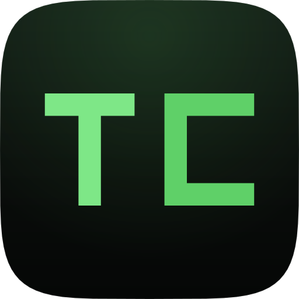

<p align="center">
  
</p>

<h1 align="center">TekuCode</h1>

<p align="center">
  A terminal-native AI coding agent, forked from
  <a href="https://github.com/anomalyco/opencode">opencode</a> (MIT).
  Cockpit layout, grass theme, and a desktop app with built-in maintenance.
</p>

<p align="center">
  
  
  
</p>

---

## What this is

TekuCode is a personal fork of opencode. The upstream agent — models, providers, tools, sessions,
permissions, the HTTP API and the SDK — is kept intact. What changes here is the shell you work in:

- **Cockpit TUI.** A dense, terminal-native layout in `packages/tui`: a left rail with sessions and
  subagents, the conversation in the center, and a docked right rail for `CONTEXT` and `PLAN`.
- **Grass theme.** One accent hue (`#5fd068`) on neutral near-black panels, square edges, no other
  saturated color except muted amber warnings and muted red deletions.
- **TekuCode Desktop.** An Electron app (`packages/desktop`) with clean-slate maintenance built in:
  database snapshot and selective restore, service restart with automatic window reload, and VPN
  rotation between ProtonVPN WireGuard profiles.
- **TC branding.** A pixel `T`/`C` lockup on a superellipse tile, generated per channel and reused for
  the web favicon, apple-touch icon and PWA manifests.

The CLI binary is still named `opencode`; renaming it is packaging work that has not happened yet.

## Requirements

- [Bun](https://bun.sh) `1.4.4` or newer (the version is pinned in `package.json`)
- A GPU-backed terminal for the TUI; a Wayland or X11 session for the desktop app
- Linux x64/arm64, macOS, or Windows for builds

## Quick start

```sh
bun install

bun run dev            # V2 CLI + cockpit TUI from source
bun run dev:live       # same, against your already-running background service and live sessions
bun run dev:desktop    # Electron desktop app (dev identity, local server)
bun run dev:web        # web UI only
```

`bun run dev` takes an optional directory, for example `bun run dev .` to open this repository.

### Cockpit TUI

| Area     | Contents                                                        |
| -------- | --------------------------------------------------------------- |
| Left     | Session tabs, then the `AGENTS` list of subagent sessions        |
| Center   | Conversation, composer, permission dialogs, diffs               |
| Right    | `CONTEXT` and `PLAN` sections with a pinned context meter       |
| Top      | Project, session, model, branch, command hint                   |
| Bottom   | State, branch, token count, cost, elapsed time                  |

The right rail docks at 110 columns and wider. `<leader>p` toggles it
(`session.rightrail.toggle`, persisted as `layout.rightRail`). The keymap is otherwise upstream's.

Render the cockpit bars without a session:

```sh
OPENCODE_STORY=cockpit bun run dev:live
```

## Desktop app

```sh
cd packages/desktop
bun run build          # builds renderer + main into out/
bun run pack           # packages into dist/desktop at the repository root
```

`bun run build` bundles the CLI from `packages/cli/dist` when it holds your target; otherwise it
downloads the matching published CLI. Production builds (`OPENCODE_CHANNEL=prod`) require a locally
built CLI. `bun run pack` produces an AppImage, `.deb` and `.rpm` on Linux, a `.app` tarball on macOS,
and the unpacked app on Windows, all unsigned.

The CLI must be built for the **same channel as the app**, otherwise the desktop app hangs on its
splash screen:

```sh
OPENCODE_CHANNEL=latest OPENCODE_VERSION=0.1.0 bun run --cwd packages/cli build --single --baseline
OPENCODE_CHANNEL=prod   OPENCODE_VERSION=0.1.0 bun run --cwd packages/desktop build
OPENCODE_CHANNEL=prod   OPENCODE_VERSION=0.1.0 bun run --cwd packages/desktop pack
```

The desktop shell looks for the background-service registration at
`$XDG_STATE_HOME/opencode/service.json`. A CLI built from a branch (for example `main`) registers as
`service-main.json`, so the shell never finds it and waits forever. Only the `latest` channel writes
`service.json`. Build the CLI with `--baseline` on x64, because `packages/desktop/script/utils.ts` maps
`linux-x64` to the baseline CLI package.

| Variable           | Meaning                                                      |
| ------------------ | ------------------------------------------------------------ |
| `OPENCODE_CHANNEL` | `local`, `dev` (default), `beta`, or `prod`/`latest`          |
| `OPENCODE_VERSION` | Version stamped into the app and its packages                 |
| `OPENCODE_TARGET`  | `linux-x64`, `linux-arm64`, `darwin-arm64`, `darwin-x64`, `windows-x64`, `windows-arm64` |

Channels use separate app identities and icon colourways so a dev and a beta build can sit side by
side: `prod` and `dev` take the ink tile, `beta` the grass tile.

## Repository layout

| Path               | Contents                                            |
| ------------------ | --------------------------------------------------- |
| `packages/schema`  | Shared wire and storage contracts                   |
| `packages/core`    | Domain behavior and persistence                     |
| `packages/protocol`| Public API definitions                              |
| `packages/server`  | HTTP server and runtime composition                 |
| `packages/cli`     | Command-line entrypoint and service lifecycle       |
| `packages/tui`     | Terminal interface — cockpit layout and grass theme |
| `packages/app`     | Shared web interface                                |
| `packages/desktop` | Electron desktop application                        |
| `packages/plugin`  | Plugin API                                          |
| `docs/`            | Cockpit spec, plan, and design notes                |

`TEKUCODE.md` in the repository root is the live state file: locked UI decisions, current status,
next steps, and the changelog. Read it before changing anything in `packages/tui`.

## Development

```sh
bun run check                  # canonical full lint + type-check
cd packages/tui && bun test    # package tests
```

Tests do not run from the repository root by design; run them from the package directory. Follow
`AGENTS.md`, and any `AGENTS.md` next to the code you are touching, for style, commit format, and
theme-token rules.

## Known issues

- `bun run check` currently fails on pre-existing `packages/core/src/plugin/provider/tor-http-client.ts`
  type errors carried over from the fork's rebrand, and `turbo` occasionally exits with `SIGSEGV`
  under `bun check`. Neither is caused by the TUI or desktop work.
- Visual verification of the cockpit at 80×24, 110×30 and 160×40 is not recorded yet.
- The CLI binary and npm packages still carry the `opencode` name.

## Upstream

- Upstream remote: `origin` → `https://github.com/anomalyco/opencode`, branch `dev`
- Fork remote: `tekucode` → `https://github.com/tekalu-git/tekucode`, branch `main`

`main` is the fork's branch. To pull upstream changes, fetch `origin` and merge or rebase `dev` onto
`main`; keep cockpit work at real seams (new components, small edits) so merges stay cheap.

## License

MIT, inherited from opencode. See [LICENSE](LICENSE). All upstream copyright notices are retained;
the TekuCode fork adds the cockpit TUI, grass theme, desktop maintenance features and branding.
